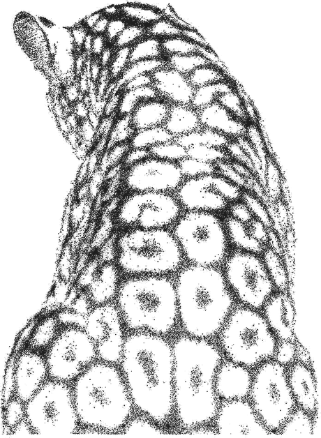

  

  

  

### About Me

As an International Baccalaureate Diploma Programme student, I am passionate about computer science, engineering, and technology. Throughout middle and high school, my experiences have centered on STEM through leadership, competition, and research. I am actively involved in organizations including the Technology Student Association, HOSA Future Health Professionals, National STEM Honor Society, and varsity swimming. I currently serve as the 2025–2026 Florida TSA State Reporter and have been elected as the 2026–2027 Florida TSA State Secretary. Through TSA, I have competed at the district, state, and national levels, earning awards in website design, software development, public speaking, and graphic design.

Through my school's Research Program, I conduct independent STEM research and compete in science and engineering fairs. My research has advanced to the State Science and Engineering Fair and has received state level recognition. Outside of research, I stay involved in STEM outreach and mentorship opportunities that support younger students entering technical and competitive programs.

Currently building: **A community platform for women in STEM!!**
Currently learning: **Python**
Looking to collaborate on: **Anything fun!!**
Fun fact: **I love rap music.**

  

### Current Projects

  

  

### Connect With Me

  
  
  
  
  
  
  
  

### GitHub Stats

  
  

  

### Words I Live By

  <em>"Being different isn't a bad thing. It means you're brave enough to be yourself."</em>
   
  <strong>— Luna Lovegood</strong>

---

<i>From <a href="https://github.com/EshunBurge">EshunBurge</a></i>

