<h3><a href="https://eshun.net/about/"><picture><source media="(prefers-color-scheme: dark)" srcset="https://raw.githubusercontent.com/EshunBurge/EshunBurge/HEAD/assets/h-hi-dark.svg"></picture></a></h3>

As an International Baccalaureate Diploma Programme student, I’m passionate about computer science, engineering and technology. I serve as the 2026–27 Florida TSA State Secretary, have competed at the district, state and national levels, and conduct independent STEM research that has advanced to the State Science and Engineering Fair. In August 2026 I founded Tesh Technology, a digital software firm that builds websites, apps and AI automation.

- **Building** · a community platform for women in STEM
- **Learning** · Python
- **Collaborate on** · anything fun
- **Fun fact** · I love rap music

<h3><a href="https://eshun.net/software-design/"><picture><source media="(prefers-color-scheme: dark)" srcset="https://raw.githubusercontent.com/EshunBurge/EshunBurge/HEAD/assets/h-projects-dark.svg"></picture></a></h3>

  
  <a href="https://teshtechnology.com"><picture><source media="(prefers-color-scheme: dark)" srcset="https://raw.githubusercontent.com/EshunBurge/EshunBurge/HEAD/assets/btn-tesh-technology-dark.svg"></picture></a>
  <a href="https://greenerpick.com"><picture><source media="(prefers-color-scheme: dark)" srcset="https://raw.githubusercontent.com/EshunBurge/EshunBurge/HEAD/assets/btn-greenerpick-dark.svg"></picture></a>
  <a href="https://blocksat.app"><picture><source media="(prefers-color-scheme: dark)" srcset="https://raw.githubusercontent.com/EshunBurge/EshunBurge/HEAD/assets/btn-blocksat-dark.svg"></picture></a>

<h3><a href="https://eshun.net/links/"><picture><source media="(prefers-color-scheme: dark)" srcset="https://raw.githubusercontent.com/EshunBurge/EshunBurge/HEAD/assets/h-connect-dark.svg"></picture></a></h3>

  
  <a href="https://www.linkedin.com/in/eshunburge"><picture><source media="(prefers-color-scheme: dark)" srcset="https://raw.githubusercontent.com/EshunBurge/EshunBurge/HEAD/assets/btn-linkedin-dark.svg"></picture></a>
  <a href="https://www.instagram.com/eshunburge"><picture><source media="(prefers-color-scheme: dark)" srcset="https://raw.githubusercontent.com/EshunBurge/EshunBurge/HEAD/assets/btn-instagram-dark.svg"></picture></a>
  <a href="https://www.tiktok.com/@eshunburge"><picture><source media="(prefers-color-scheme: dark)" srcset="https://raw.githubusercontent.com/EshunBurge/EshunBurge/HEAD/assets/btn-tiktok-dark.svg"></picture></a>
  <a href="https://www.pinterest.com/eshunburge"><picture><source media="(prefers-color-scheme: dark)" srcset="https://raw.githubusercontent.com/EshunBurge/EshunBurge/HEAD/assets/btn-pinterest-dark.svg"></picture></a>
  <a href="https://eshun.net/links/"><picture><source media="(prefers-color-scheme: dark)" srcset="https://raw.githubusercontent.com/EshunBurge/EshunBurge/HEAD/assets/btn-all-links-dark.svg"></picture></a>

<h3><a href="https://github.com/EshunBurge?tab=repositories"><picture><source media="(prefers-color-scheme: dark)" srcset="https://raw.githubusercontent.com/EshunBurge/EshunBurge/HEAD/assets/h-github-dark.svg"></picture></a></h3>

  <a href="https://github.com/EshunBurge?tab=repositories"><picture><source media="(prefers-color-scheme: dark)" srcset="https://github-readme-stats-five-sigma-99.vercel.app/api?username=EshunBurge&amp;show_icons=true&amp;count_private=true&amp;border_radius=16&amp;bg_color=1b1b1e&amp;title_color=f4f4f5&amp;text_color=d4d4d8&amp;icon_color=ff5c9d&amp;ring_color=ff5c9d&amp;border_color=34343b"></picture></a>
  <a href="https://github.com/EshunBurge?tab=repositories"><picture><source media="(prefers-color-scheme: dark)" srcset="https://github-readme-stats-five-sigma-99.vercel.app/api/top-langs/?username=EshunBurge&amp;layout=compact&amp;langs_count=8&amp;border_radius=16&amp;bg_color=1b1b1e&amp;title_color=f4f4f5&amp;text_color=d4d4d8&amp;icon_color=ff5c9d&amp;ring_color=ff5c9d&amp;border_color=34343b"></picture></a>

 

  <em>“Being different isn’t a bad thing. It means you’re brave enough to be yourself.”</em> 
  — Luna Lovegood

